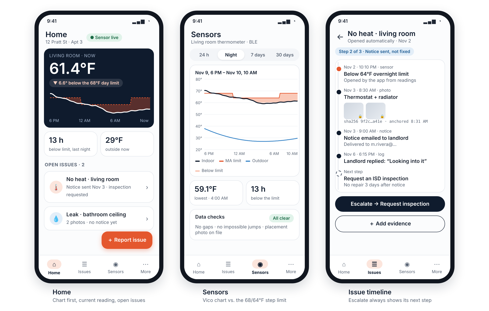
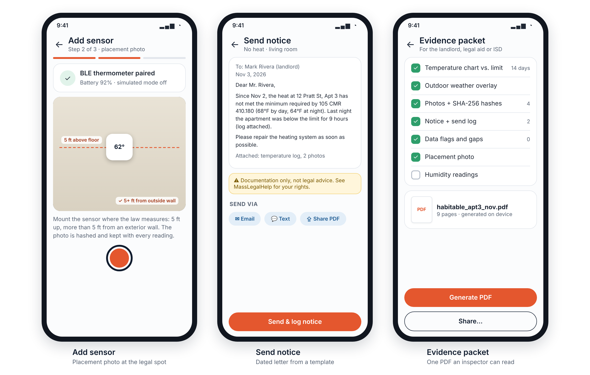

# Habitable

Android app that helps Boston renters document heat and repair problems so they can get them fixed.

A Bluetooth LE thermometer logs the room temperature and the app compares it against the Massachusetts heat rules (68°F from 7 AM to 11 PM, 64°F overnight, September 15 to May 31). Tenants add photos that are hashed when they're taken, send a dated notice to the landlord, and export one PDF packet that helps get a housing inspector to come out.

CS 501 E1, Mobile Application Development, Boston University, Fall 2026
Team: **Ankita Patra** and **Priyanshu Singh**

> Habitable is a documentation tool, not legal advice. An inspector's measurement is the official one.

## Design mockups




*Mockups only; the app is in development.*

## MVP features

1. BLE temperature and humidity logging, plus a simulated-sensor mode for demos
2. Heat rules: 68/64°F by time of day, 78°F maximum, heating season
3. Charts (Vico) on Home, Sensors and in the PDF
4. Outdoor temperature from Open-Meteo on the same chart
5. CameraX photos with a SHA-256 hash taken at capture
6. Issue tracker with a timeline
7. Dated repair-notice templates, inspection-request guidance, and conditional follow-up reminders based on documented issue status and applicable Massachusetts housing guidance.
8. On-device PDF packet

## Tech stack

| Layer | Choice |
| --- | --- |
| UI | Kotlin, Jetpack Compose, Material 3, Navigation Compose |
| State | ViewModel + StateFlow |
| Local data | Room (source of truth), DataStore |
| Device | Bluetooth LE (foreground service), CameraX, WorkManager |
| Charts | Vico |
| Third-party API | Open-Meteo |
| Backend | Node.js + Express, JWT, PostgreSQL (Render + Neon free tiers) |

## Repository layout

```
android/    Android app (Kotlin, Compose)
backend/    Node.js + Express API
docs/       Proposal, mockups, backlog
```

## Getting started

**Android:** open `android/` in Android Studio (Ladybug or newer), let Gradle sync, then run on a device or emulator with Android 10+. Simulated-sensor mode is on by default, so no hardware is needed.

**Backend:**

```bash
cd backend
cp .env.example .env   # set DATABASE_URL and JWT_SECRET
npm install
npm run dev
```

## Milestones

| Date | Milestone |
| --- | --- |
| Oct 20 | Proposal and backlog |
| Nov 10 | Update 1: simulator → Room → chart with outdoor weather → auto heat issue |
| Nov 24 | Update 2: feature-complete beta |
| Dec 8 | Final app, paper and demo |

## How we work

- `main` is protected; work happens on `feat/<area>-<short-name>` branches
- Every pull request is reviewed by the other teammate before merging
- Tasks are tracked in GitHub Issues and Projects
- Secrets stay in `local.properties` and `.env`, never in the repo

## References

- [105 CMR 410.180, Temperature Requirements](https://regulations.justia.com/states/massachusetts/105-cmr/title-105-cmr-410-000/section-410-180)
- [MGL c.111 §127L](https://malegislature.gov/Laws/GeneralLaws/Chapter111/Section127L)
- [MassLegalHelp, Legal Tactics Ch. 8: Getting Repairs Made](https://www.masslegalhelp.org/)
- [Open-Meteo](https://open-meteo.com/)
